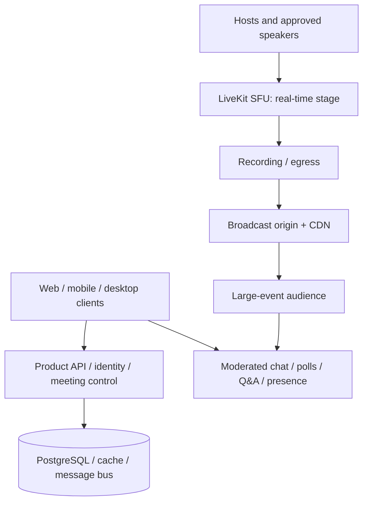

# MegaMeet — open project blueprint

> **Status: Planning / architecture. No working MegaMeet application has been committed yet.**
>
> **MegaMeet** is the provisional product name for an independent video-meeting and collaboration platform aiming to compete on experience and capability with Zoom, Google Meet, and Microsoft Teams. This repository's historical name (`google-meet`) does **not** imply any affiliation with Google.

## What we're building

A browser-first, mobile-ready, commercially viable meeting platform that combines:

- High-quality real-time group meetings (camera, microphone, screen sharing, chat, host controls).
- Team collaboration (scheduling, notes, whiteboards, polls, Q&A, recordings, accessibility).
- Enterprise foundations (organizations, SSO, administration, security, auditability).
- Optional AI capabilities (captions, transcription, summaries, translations, subject to consent and privacy).
- **A distinct large-event mode targeting 100,000+ concurrent audience members in one logical event**, with a limited live speaker stage, moderated interaction, and distributed media delivery.

**A 100,000-person interactive room is not the same thing as a 100,000-person broadcast.** We intend to build and validate the latter first. The 100K target is **not a current capability or guarantee**.

## Start here

| If you're... | Read |
| --- | --- |
| New to the project | [Project vision](docs/PROJECT_VISION.md) and [Product requirements](docs/PRODUCT_REQUIREMENTS.md) |
| A developer choosing a task | [Roadmap](docs/ROADMAP.md), [Contribution guide](CONTRIBUTING.md), and [Definition of done](docs/DEFINITION_OF_DONE.md) |
| A backend/media engineer | [System architecture](docs/ARCHITECTURE.md) and [100K scaling plan](docs/SCALABILITY_100K.md) |
| Evaluating open source components | [Technology and reuse matrix](docs/TECH_STACK.md) and [Licensing notes](docs/LICENSING.md) |
| Working with Codex or another AI coding agent | [AGENTS.md](AGENTS.md) and [Codex work orders](docs/CODEX_TASKS.md) |
| Reviewing security or operations | [Security and privacy](docs/SECURITY_PRIVACY.md) and [Operational cost model](docs/COST_MODEL.md) |

## Architecture in one minute

We favor **one application monorepo with multiple independently deployable services**. Reuse mature engines instead of copying entire competing meeting applications into one codebase. The proposal is **LiveKit Meet/Components + LiveKit media stack** for normal meetings and live speakers; a **separate broadcast/CDN path** for large audiences; and targeted reusable components for identity, collaboration, and messaging. No production stack selection is final until the architecture/license review.

## Project stage and honesty about implementation

- [x] Project mission, proposed architecture, roadmap, component shortlist, and contributor workflow documented.
- [ ] Product code and local development environment implemented.
- [ ] Authentication and first functional end-to-end meeting.
- [ ] Scheduling, collaboration, moderation, recording, enterprise and AI features.
- [ ] Integrated scalable live-event mode.
- [ ] Measured 1K, 10K, and 100K concurrent-audience tests.
- [ ] Independent production security review, accessibility review, and release.

An empty checkbox is **planned work**, not a delivered feature. See the [roadmap](docs/ROADMAP.md) for milestone gates.

## What to do first

1. Read [CONTRIBUTING.md](CONTRIBUTING.md) and the [roadmap](docs/ROADMAP.md).
2. Open an issue proposing a *small, testable* change; align it with a milestone before starting.
3. Prioritize an upstream/license audit, an architecture decision record, and the initial application skeleton over duplicate implementations of WebRTC, authentication protocols, or whiteboard engines.
4. Propose a focused pull request with tests and documentation. Never claim performance beyond tested evidence.

## Code ownership and licensing

**No license for MegaMeet's original code has been selected yet.** Public visibility alone does not grant unrestricted permission to reuse the repository. Third-party projects retain their own licenses. The owner must decide the code/contribution license before accepting substantive source contributions; see [Licensing](docs/LICENSING.md). Do **not** import upstream source files without a verified license and attribution process.

## Links

- [GitHub issues](https://github.com/arunabanarjee32-bit/google-meet/issues) — proposed work and discussions
- [Repository](https://github.com/arunabanarjee32-bit/google-meet) — canonical project home

**Maintainer note:** The name MegaMeet is a working label, not a cleared trademark or registered brand. Product naming and licensing remain open decisions.

## Task management linkage

See the [GitHub phase-issue index](docs/ISSUE_INDEX.md), [master plan](docs/DELIVERY_MASTER_PLAN.md), [178-task backlog](docs/TASK_BACKLOG.md), and [credit policy](docs/CODEX_CREDIT_POLICY.md). Each PR should reference a task ID of the form `MM-04-02` and a milestone gate. One task should be one reviewable change where practical.

## Public repositories for study

The consolidated [30-repository study catalog](PUBLIC_REPOSITORIES_TO_STUDY.txt) lists every previously discussed GitHub repository with its purpose, study priority, reported licensing and integration cautions. It also distinguishes cloud services such as AWS IVS and Cloudflare Stream from open-source source repositories.
