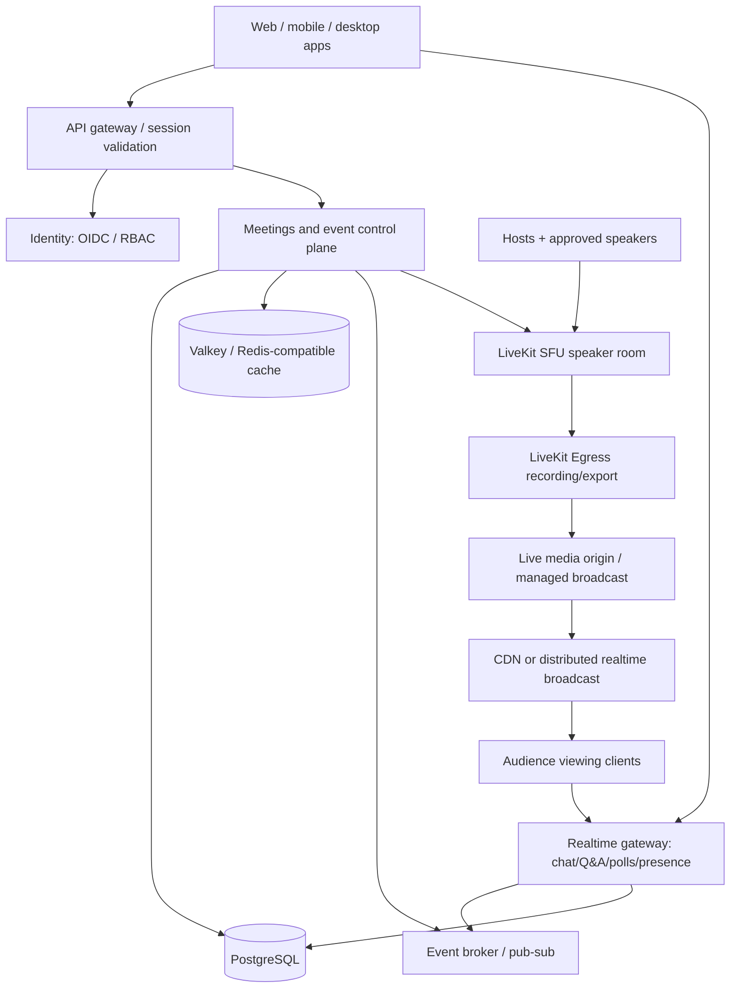

# Proposed system architecture

**Document type:** reference design; **not implemented**. Final component choices need architecture decision records (ADRs), license reviews and performance tests.

## One application, separate media paths



**Two modes, one event identity:**

1. **Interactive meeting:** bounded participants communicate via SFU; host permissions and SDK subscription strategies control what each client sends and receives.
2. **Large event:** a limited group of live speakers publishes to an SFU; output is encoded/exported for distributed delivery, while audience chat, polls, Q&A and attendance use independent services. Participants belong to the same **logical event**, not necessarily the same media room.

No browser must subscribe to 100,000 distinct camera feeds. A fully interactive 100K-way room is not the stated target.

## Monorepo proposal (future layout)

```text
apps/
  web/                 # browser UI and guest join
  mobile/              # React Native, later milestone
  desktop/             # optional packaged shell, later
  admin/               # organization/admin experience
services/
  api/                 # control APIs and session orchestration
  chat/                # persistence, moderation, gateways
  event-control/       # stage roles, attendance, Q&A, polls
  recording/           # jobs, permissions, artifact lifecycle
  broadcast/           # provider adapters and health checks
  ai/                  # optional consent-based pipelines
packages/
  ui/                  # design system
  contracts/           # API types and schema
  auth/                # shared authorization helpers
  config/              # validated runtime config
infra/                 # reproducible local/prod definitions
docs/                  # decisions and runbooks
```

This is a proposed directory plan; do not scaffold empty services until milestones require them.

## Important contracts

- **Identity and access:** OIDC for people; server-signed short-lived tokens for media rooms/events. Distinguish `host`, `moderator`, `speaker`, `attendee`, `viewer`. Treat every role elevation as an audited backend decision.
- **Meeting service:** create, schedule, join, revoke, end; event/room ID mapping; capacity and region policy; idempotent API operations.
- **Media adapter:** join room, publish/subscribe, egress recording/broadcast, monitor quality. Never expose media provider secrets to clients.
- **Broadcast adapter:** start/stop output, signed viewer access, latency metadata, stream state, provider quotas, errors; support replaceable managed providers and future self-hosting.
- **Interaction plane:** per-event channels for chat/Q&A/polls/hand raises; bounded message sizes; rate limits; moderation; fanout sharding; ordering expectations explicit.
- **Persistence:** PostgreSQL for canonical user/organization/event/permission/recording metadata; object storage for recordings; cache for short-lived presence/session state. Avoid storing all high-frequency presence events as DB rows.
- **Events:** define idempotency keys, schema versioning, retries, dead-letter behavior and metrics for meeting.started, participant.joined, stage.requested, stage.approved, stream.failed, recording.started and meeting.ended.

## Trust boundaries

Client inputs are untrusted. Enforce meeting admission, speaker promotion, recording access, moderation, webhook authentication and tenant isolation on the server. Support signed playback, consent, deletion/retention, audit logs, abuse detection and least privilege. Consider TURN for NAT traversal if self-hosting. See [Security and privacy](SECURITY_PRIVACY.md).

## Scale and latency caveats

A CDN helps distribute video; it does **not** independently solve chat, presence, moderation, synchronized stage promotion or record permissions. Egress is not a CDN. HLS/LL-HLS and WebRTC distribution have different latency/cost/device tradeoffs. Treat these as product modes with explicit user-facing behavior.

Use load tests for join bursts, steady state, reconnect storms, live stage swaps, regional degradation, and authentication/messaging workloads; see [100K design](SCALABILITY_100K.md).

## Architecture decisions required

- ADR-0001: One monorepo and external services, not several merged meeting apps.
- ADR-0002: LiveKit for interactive meeting foundation (pending license and cost signoff).
- ADR-0003: Broadcast provider/CDN vs self-hosted origin; latency and viewer-hour cost assumptions.
- ADR-0004: Identity provider vs application-level authentication, retention and regional data constraints.
- ADR-0005: Licensing/brand strategy before original source code contributions.

A proposal or ADR must record alternatives, benefits, costs, risks and rollback/migration options.
