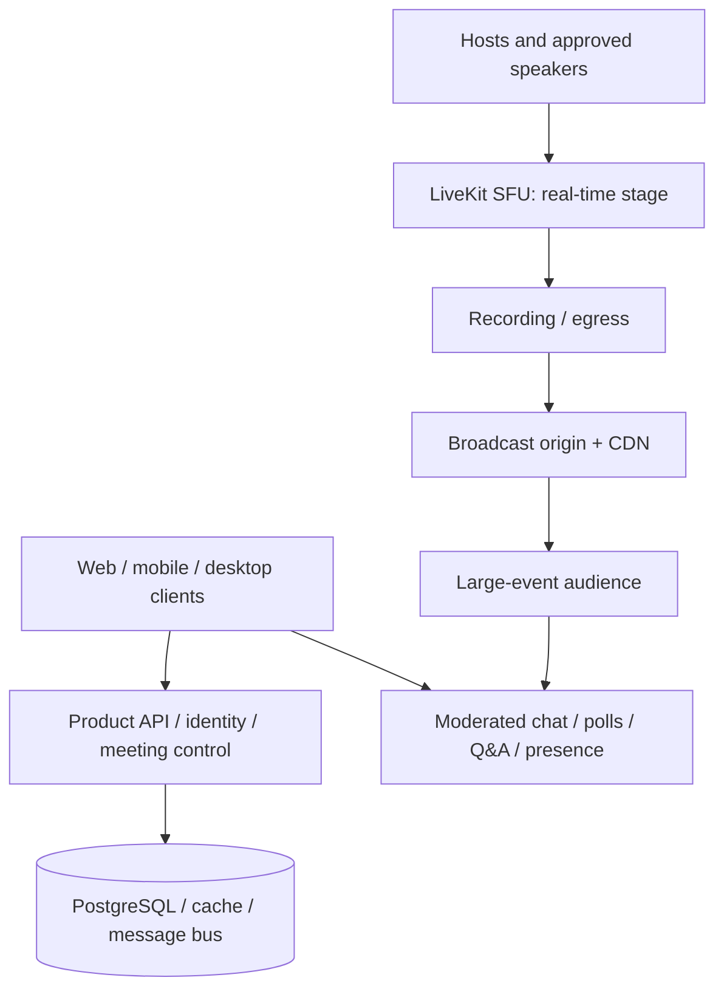

# MegaMeet source-document snapshot — Part 1 of 5

**Captured:** 2026-11-16. **Baseline branch:** main. **Main tree:** dd2284f26f7822c086bef5070839364e42c01d8f.

> Full-text archival copies of existing files for context restoration, not replacements for the original living documents. Do not treat descriptions as implemented features. Part 1: project intro, AI instructions, contribution/security governance, vision, requirements.

## README.md

Original: https://github.com/arunabanarjee32-bit/google-meet/blob/main/README.md  
Blob SHA: 87133105786697f90059295f058dd669170bc4f0

~~~~markdown
# MegaMeet — open project blueprint

> **Status: Planning / architecture. No working MegaMeet application has been committed yet.**
>
> **MegaMeet** is the provisional product name for an independent video-meeting and collaboration platform aiming to compete on experience and capability with Zoom, Google Meet, and Microsoft Teams. This repository's historical name (`google-meet`) does **not** imply any affiliation with Google.

## What we're building

A browser-first, mobile-ready, commercially viable meeting platform that combines:

- High-quality real-time group meetings (camera, microphone, screen sharing, chat, host controls).
- Team collaboration (scheduling, notes, whiteboards, polls, Q&A, recordings, accessibility).
- Enterprise foundations (organizations, SSO, administration, security, auditability).
- Optional AI capabilities (captions, transcription, summaries, translations, subject to consent and privacy).
- **A distinct large-event mode targeting 100,000+ concurrent audience members in one logical event**, with a limited live speaker stage, moderated interaction, and distributed media delivery.

**A 100,000-person interactive room is not the same thing as a 100,000-person broadcast.** We intend to build and validate the latter first. The 100K target is **not a current capability or guarantee**.

## Start here

| If you're... | Read |
| --- | --- |
| New to the project | [Project vision](docs/PROJECT_VISION.md) and [Product requirements](docs/PRODUCT_REQUIREMENTS.md) |
| A developer choosing a task | [Roadmap](docs/ROADMAP.md), [Contribution guide](CONTRIBUTING.md), and [Definition of done](docs/DEFINITION_OF_DONE.md) |
| A backend/media engineer | [System architecture](docs/ARCHITECTURE.md) and [100K scaling plan](docs/SCALABILITY_100K.md) |
| Evaluating open source components | [Technology and reuse matrix](docs/TECH_STACK.md) and [Licensing notes](docs/LICENSING.md) |
| Working with Codex or another AI coding agent | [AGENTS.md](AGENTS.md) and [Codex work orders](docs/CODEX_TASKS.md) |
| Reviewing security or operations | [Security and privacy](docs/SECURITY_PRIVACY.md) and [Operational cost model](docs/COST_MODEL.md) |

## Architecture in one minute

We favor **one application monorepo with multiple independently deployable services**. Reuse mature engines instead of copying entire competing meeting applications into one codebase. The proposal is **LiveKit Meet/Components + LiveKit media stack** for normal meetings and live speakers; a **separate broadcast/CDN path** for large audiences; and targeted reusable components for identity, collaboration, and messaging. No production stack selection is final until the architecture/license review.

## Project stage and honesty about implementation

- [x] Project mission, proposed architecture, roadmap, component shortlist, and contributor workflow documented.
- [ ] Product code and local development environment implemented.
- [ ] Authentication and first functional end-to-end meeting.
- [ ] Scheduling, collaboration, moderation, recording, enterprise and AI features.
- [ ] Integrated scalable live-event mode.
- [ ] Measured 1K, 10K, and 100K concurrent-audience tests.
- [ ] Independent production security review, accessibility review, and release.

An empty checkbox is **planned work**, not a delivered feature. See the [roadmap](docs/ROADMAP.md) for milestone gates.

## What to do first

1. Read [CONTRIBUTING.md](CONTRIBUTING.md) and the [roadmap](docs/ROADMAP.md).
2. Open an issue proposing a *small, testable* change; align it with a milestone before starting.
3. Prioritize an upstream/license audit, an architecture decision record, and the initial application skeleton over duplicate implementations of WebRTC, authentication protocols, or whiteboard engines.
4. Propose a focused pull request with tests and documentation. Never claim performance beyond tested evidence.

## Code ownership and licensing

**No license for MegaMeet's original code has been selected yet.** Public visibility alone does not grant unrestricted permission to reuse the repository. Third-party projects retain their own licenses. The owner must decide the code/contribution license before accepting substantive source contributions; see [Licensing](docs/LICENSING.md). Do **not** import upstream source files without a verified license and attribution process.

## Links

- [GitHub issues](https://github.com/arunabanarjee32-bit/google-meet/issues) — proposed work and discussions
- [Repository](https://github.com/arunabanarjee32-bit/google-meet) — canonical project home

**Maintainer note:** The name MegaMeet is a working label, not a cleared trademark or registered brand. Product naming and licensing remain open decisions.

## Task management linkage

See the [GitHub phase-issue index](docs/ISSUE_INDEX.md), [master plan](docs/DELIVERY_MASTER_PLAN.md), [178-task backlog](docs/TASK_BACKLOG.md), and [credit policy](docs/CODEX_CREDIT_POLICY.md). Each PR should reference a task ID of the form `MM-04-02` and a milestone gate. One task should be one reviewable change where practical.

## Public repositories for study

The consolidated [30-repository study catalog](PUBLIC_REPOSITORIES_TO_STUDY.txt) lists every previously discussed GitHub repository with its purpose, study priority, reported licensing and integration cautions. It also distinguishes cloud services such as AWS IVS and Cloudflare Stream from open-source source repositories.

~~~~

---

## AGENTS.md

Original: https://github.com/arunabanarjee32-bit/google-meet/blob/main/AGENTS.md  
Blob SHA: ff6e837b3c50ee072c00b21d9b24d11a6b6db13b

~~~~markdown
# Instructions for Codex and other coding agents

This document is the repository-level operating manual for AI assistants. **Read README, docs/PROJECT_VISION.md, docs/PRODUCT_REQUIREMENTS.md, docs/ARCHITECTURE.md, docs/ROADMAP.md, docs/TECH_STACK.md, docs/LICENSING.md and CONTRIBUTING.md first.**

## Project facts that must not be invented

- MegaMeet is a **working name** for an independently branded meeting/collaboration product; the repo path does not create Google affiliation.
- This repo initially contains **planning documentation only**. Do not claim code, tests, deployments or 100K concurrency already exist unless you can point to verified artifacts.
- 100,000+ applies to **concurrent audience viewers for a single logical event with a bounded active-speaker stage**, not 100K simultaneously publishing video tracks.
- The owner's license for original code is **not yet selected**. Do not import or submit substantive third-party code until licensing/contribution authorization is clear.
- A GitHub public repo or a production-facing README is not evidence of implementation.

## Working method to minimize Codex credits

1. **Inventory first.** Inspect real files, check current implementation and constraints; avoid rewriting working functionality.
2. **Reuse audit.** For every major feature, list mature candidates, exact license/version, integration cost and risks. Prefer packages/services over copying whole applications.
3. **Scope first.** Propose a small milestone, measurable acceptance tests, file paths and a credit/time budget before starting a large feature.
4. **Implement vertically.** One working user flow at a time. No placeholder service forests, fake dashboards or fabricated tests.
5. **Verify visibly.** Run available local tests/linters/builds, report commands, outputs and remaining gaps.
6. **Stop on blockers.** Ask for owner decision on code license, provider credentials, paid vendor commitments, high-impact architecture changes and security/privacy policies.
7. **No secret handling in Git.** Use environment variables, sample .env files without credentials, and appropriate secrets managers in deployment.
8. **Explain the result.** Provide concise diff summary, third-party dependencies added, licensing notes, tests, costs and next discrete step.

## Default proposed stack (NOT pre-approved or installed)

- Primary web app: Next.js/React/TypeScript, building from Apache-2.0 LiveKit Meet where legally vetted.
- AV: LiveKit SDK/Components/Server; Egress for recording and stream output.
- Interactive broadcast: bounded WebRTC speaker stage + separate managed CDN broadcast distribution.
- Realtime interactions: backend event model + scalable transport; evaluate Centrifugo, Valkey and a broker as warranted.
- Identity: OIDC/Keycloak evaluation; PostgreSQL for canonical domain data.
- Whiteboard/state: Excalidraw/Yjs after their package-level license audit.
- Optional later: React Native, captions/Whisper/agents, scheduling, enterprise SSO, billing.

Do **not** silently replace this proposal with a completely different media engine or merge competing conferencing stacks.

## Requirements for any code PR

- Every feature linked to an issue, milestone and acceptance criteria.
- No accidental tenant/room data leakage or unsigned role elevation.
- Recording and AI transcription **opt-in/visible with consent logic**, per policy.
- Use dependency lockfiles, environment schema, tests, structured logging and documented rollback.
- Meet accessibility expectations; never rely on mouse-only controls.
- Include a tested upgrade path and deployment impact when adding stateful services.
- No 100K capability claim without measured actual viewers, quota checks and evidence described in docs/SCALABILITY_100K.md.

## First safe tasks

- Perform license/version audit and draft decisions (no source import).
- Propose minimal skeleton and CI after license decision.
- Implement two-browser secure meeting flow as Phase 1, with tests.
- Add large event mode only after the basic meeting path is reliable.

See [Codex work orders](docs/CODEX_TASKS.md) for copyable scoped assignments.

## Delivery work orders and model assignment

The authoritative **178-task, 14-phase** task breakdown is [docs/TASK_BACKLOG.md](docs/TASK_BACKLOG.md); the master rollout/gates are in [docs/DELIVERY_MASTER_PLAN.md](docs/DELIVERY_MASTER_PLAN.md). Work on one narrow task ID at a time using [docs/CODEX_CREDIT_POLICY.md](docs/CODEX_CREDIT_POLICY.md). **Codex GPT-6.1 Sol is the default implementation lane**; **Astra is an exception/escalation lane**; **GPT-6 in Chat drafts specs and small patches but does not substitute for passing actual tests**. Maintainer approval is mandatory at legal, paid infrastructure, high-risk security and release gates. Do not assign a task to multiple agents concurrently editing the same files.

~~~~

---

## CONTRIBUTING.md

Original: https://github.com/arunabanarjee32-bit/google-meet/blob/main/CONTRIBUTING.md  
Blob SHA: ec606cf7b4dc3177972e722a21b93963b5965d70

~~~~markdown
# Contributing to MegaMeet

Welcome! **MegaMeet is a planned product with architecture documentation, not a finished meeting system.** You should be able to understand the mission without access to any past chats.

## Read before starting

1. [README.md](README.md) — status and high-level overview.
2. [Project vision](docs/PROJECT_VISION.md) — why this product should exist.
3. [Requirements](docs/PRODUCT_REQUIREMENTS.md) — what users should be able to do.
4. [Architecture](docs/ARCHITECTURE.md) — how normal meetings differ from 100K events.
5. [Roadmap](docs/ROADMAP.md) — prioritize milestones.
6. [Tech stack](docs/TECH_STACK.md), [Licensing](docs/LICENSING.md), and [Definition of done](docs/DEFINITION_OF_DONE.md).

## Important: licensing decision is open

The repository owner **has not yet chosen a license for original MegaMeet code**. Please begin with issue discussions, small documentation corrections and architecture/license proposals. Do **not** submit substantive source-code copies or licensed upstream code until the owner sets the contribution/license policy. Public repository access does not imply an open-source license.

## How to propose work

- Search [issues](https://github.com/arunabanarjee32-bit/google-meet/issues) for duplication.
- Create a feature, audit or bug issue that includes **user impact, milestone, reuse candidates, scope, acceptance tests, legal/security considerations, and proposed cost impact**.
- For an architectural choice, write an ADR proposal listing alternatives, consequences, migration/fallback, and tradeoffs.
- Get maintainer alignment on high-risk dependency, public license, privacy, vendor or architecture decisions before coding.

## Pull request process (once source contributions are authorized)

1. Create a focused branch from the current default branch.
2. Keep a PR small and scoped to one issue or vertical slice; don't independently scaffold the whole company.
3. Link the issue; note which tested behavior changed and what did **not** change.
4. Run available lint, type, unit, integration and security checks. If not available yet, say so. Never manufacture green CI results.
5. Include docs updates, architecture decision and changelog note as needed.
6. Preserve upstream notices, lockfiles and exact versions; do not copy unlicensed snippets or secrets.
7. Have a human reviewer approve changes that affect authentication, permissions, recording, data deletion, payments, security or infrastructure costs.

## Code and design principles

- Prefer well-maintained libraries/services for media, identity, realtime messaging and drawing rather than inventing replacements.
- Start with one TypeScript/Next.js app and add services only for proven needs.
- Enforce permissions server-side; keep media provider secrets and API keys off clients.
- Build for accessibility (keyboard and screen readers), localization and poor networks.
- Keep low-latency stage and higher-latency audience state distinct; test transitions and echo handling.
- Use feature flags and migration plans to avoid breaking existing flows.
- Document unsupported browsers, limits and consent requirements.
- Evaluate software supply-chain security and third-party licenses.

## PR template and review

GitHub will populate the checklist in [.github/PULL_REQUEST_TEMPLATE.md](.github/PULL_REQUEST_TEMPLATE.md). Use our [Definition of Done](docs/DEFINITION_OF_DONE.md).

## Communication

Be constructive and specific. Report security problems privately (see [SECURITY.md](SECURITY.md)), never in a public issue with exploit details. No maintainers, support channels, response-time guarantees, or release dates are implied by these documents.

~~~~

---

## SECURITY.md

Original: https://github.com/arunabanarjee32-bit/google-meet/blob/main/SECURITY.md  
Blob SHA: 5085fc62a2889e424d689745084cab6cb5e256c6

~~~~markdown
# Security policy — planning stage

**MegaMeet does not currently ship a production application or have a public vulnerability disclosure mailbox.** Please avoid posting exploit details or secrets in public issues, discussions, or pull requests.

If you identify a security concern in project documentation or future code, use GitHub's private vulnerability reporting feature **if it is enabled for this repository**, or contact the repository owner through an established private channel. Do not assume a response SLA or bounty program.

In reports, include the affected commit/version, a high-level impact description and steps to reproduce **privately** with scrubbed test data. Never attach real user recordings, tokens or credentials.

See [Security and privacy requirements](docs/SECURITY_PRIVACY.md). A formal supported-version and disclosure policy should be published before a production release.

~~~~

---

## docs/PROJECT_VISION.md

Original: https://github.com/arunabanarjee32-bit/google-meet/blob/main/docs/PROJECT_VISION.md  
Blob SHA: 8cd59540f3c70026def74662c6a8cdbb2a503e6c

~~~~markdown
# Project vision and operating principles

**Status: proposal, not a shipped product.** **MegaMeet** is the *working* name for a commercial-quality, independent video-meeting and collaboration platform. The aim is to become a credible competitor to Zoom Workplace, Google Meet, and Microsoft Teams, not to copy their branding or assert market leadership.

## Mission

Make high-quality, secure, accessible meetings and collaborative events available from one coherent product, from a two-person call to an event with **100,000+ concurrent viewers**. People should use one link and one identity while media delivery adapts to audience size.

## Users and jobs-to-be-done

1. **Individuals and teams:** create a meeting quickly, join in a browser, share a screen, chat, record with consent, and follow up.
2. **Hosts and moderators:** admit/mute/remove people, manage speakers, run polls and Q&A, prevent abuse, review attendance and recordings.
3. **Organizations:** central administration, SSO, policy and data controls, reliable scheduling, compliance support, integrations.
4. **Event organizers:** register large audiences, offer a responsive live stage, audience-wide captions, moderated interactions and analytics.
5. **Developers and partners:** stable APIs, documented deployments, webhooks and extension interfaces.

## Product differentiation hypotheses (to validate with customers)

- **Meeting-to-event continuity:** start a normal call and expand to a controlled broadcast without forcing participants onto a different product.
- **Cost and operational transparency:** clear quality/latency/capacity modes and predictable usage-based streaming costs.
- **Accessibility and multilingual participation:** real-time captions and translation, with transparent consent and graceful low-bandwidth operation.
- **Developer-friendly and self-hostable options** where feasible, without implying the full system is currently self-hosted or production-ready.
- **Trust by design:** secure defaults, host moderation, explicit recording disclosures, admin controls.

These are hypotheses, not achieved differentiators. Interview potential customers and validate before building everything.

## Non-negotiable engineering principles

- **Reuse before build:** audit mature, maintained libraries and licenses before asking Codex to invent an engine.
- **One product, modular architecture:** main monorepo for original application code; external components used as packages/services.
- **Measure instead of promise:** availability, quality, latency, load, privacy and security must be demonstrated.
- **Stage and audience are different:** the 100K audience primarily watches; only a smaller controlled speaker group publishes.
- **Avoid irreversible lock-in:** define interfaces for authentication, broadcast providers and persistence.
- **Privacy/security/accessibility from the start:** do not bolt them on at launch.
- **Contributors need evidence:** document changes, tests, costs and trade-offs.

## Non-goals for initial delivery

- A new custom WebRTC SFU or a replacement for the entire browser media stack.
- A 100,000-person fully meshed audio/video room with every camera/mic live.
- Every enterprise compliance certification at first release.
- Guaranteed sub-second latency for everyone across all world regions.
- A feature-by-feature clone of proprietary competitor implementations.

## North-star outcomes and measurable quality gates

The roadmap prioritizes reliable user outcomes. Proposed benchmarks for eventual release (subject to discovery and cost evaluation):

| Dimension | What to measure |
| --- | --- |
| Join UX | Time from clicking a link to usable audio/video; browser and mobile success rate |
| Quality | Media connection success, rebuffer ratio, packet loss, adaptation, screen-share readability |
| Reliability | Availability SLO, call drop/recovery rate, graceful degradation under load |
| Security | AuthZ coverage, abuse handling, incident response, dependency and penetration-test findings |
| Accessibility | WCAG-oriented keyboard, screen reader, captions and high-contrast QA |
| Scale | Evidence at 100, 1K, 10K, then 100K concurrent **audience** connections |
| Cost | Actual cost per viewer-hour, meeting-hour, and active speaker-hour |
| Product | Retention, host success rate, user satisfaction, willingness to pay |

## Open decisions

Ownership/legal structure; final product name and trademark clearance; initial customer segment; repository license; hosting regions; provider selection; latency target; retention periods; pricing; launch scope. Decisions belong in documented ADRs and should not be assumed by AI agents.

See [Requirements](PRODUCT_REQUIREMENTS.md), [Architecture](ARCHITECTURE.md), and [Roadmap](ROADMAP.md).

~~~~

---

## docs/PRODUCT_REQUIREMENTS.md

Original: https://github.com/arunabanarjee32-bit/google-meet/blob/main/docs/PRODUCT_REQUIREMENTS.md  
Blob SHA: 19c755d6313f67ccd960184847728b6d9936a83d

~~~~markdown
# Product requirements and feature inventory

**Status:** target capabilities, not implemented functionality. Priorities are proposed and must be adjusted after user research. **P0** = first working product, **P1** = competitive core, **P2** = enterprise/advanced, **P3** = later. "Reuse" means integrate a dependency; it does not mean the feature works automatically.

## Roles and permissions

- **Platform operator:** account/platform health, safety, abuse and incident management.
- **Organization administrator:** members, SSO, policies, audit logs and billing.
- **Meeting organizer / host:** schedule, admit, remove, mute, recording/streaming and stage controls.
- **Co-host/moderator:** configured subset of host actions.
- **Speaker/presenter:** publish media and share screen with authorization.
- **Attendee:** join a standard conference with host-controlled media privileges.
- **Broadcast viewer:** watch live content, ask approved questions, chat/poll according to policy; no media publish by default.

Enforce authorization on the server even if a UI button is hidden.

## Feature matrix

| Area | Feature | Priority | Build vs reuse |
| --- | --- | --- | --- |
| Identity | Signup/login, accounts, session management | P0 | Integrate vetted identity provider; custom UX |
| Meetings | Create/join by secure link, lobby, role tokens | P0 | LiveKit SDK + own control API |
| AV | Microphone, camera, device selection, adaptive video | P0 | LiveKit + browser/mobile SDK |
| Meetings | Screen sharing, layouts, participant roster | P0 | LiveKit Components + custom UX |
| Controls | Admit/mute/kick/lock, role-based permissions | P0 | Own policy layer over LiveKit |
| Collaboration | Persistent meeting chat with moderation | P1 | Messaging transport + own storage/moderation |
| Scheduling | Calendar, invites, timezone support | P1 | Reuse calendar UI, integrate provider APIs later |
| Recording | Explicit start/stop consent, storage, playback | P1 | LiveKit Egress + access policy |
| Accessibility | Keyboard/screen reader/captions baseline | P1 | UI/a11y practices and vetted caption service |
| Collaboration | Polls, hand raise, moderated Q&A | P1 | Own domain workflows and realtime events |
| Collaboration | Whiteboard and shared notes | P1 | Excalidraw + Yjs integration |
| Large events | Organizer registration and viewer admission | P1 | Own control plane |
| Large events | Speaker stage + audience broadcast | P1 | LiveKit + Egress + broadcast/CDN |
| Large events | Raise hand -> request -> moderated stage promotion | P1 | Own orchestrator, LiveKit permissions |
| Mobile | Android and iOS application | P2 | React Native LiveKit SDK + custom app |
| Enterprise | Organizations, SSO, policy, audit export | P2 | Keycloak/OIDC + own management layer |
| Enterprise | Retention, legal hold options, region control | P2 | Own data governance + hosting capabilities |
| AI | Consent-based transcript, summary, translation | P2 | Model/agent integrations; human-readable disclosures |
| Business | Payments, plans, usage metering, invoices | P2 | Payment/billing integration |
| Developer | Webhooks, API docs, SDK and integrations | P2 | Own API contracts |
| Advanced | Breakouts, PSTN, SIP, live interpretation | P3 | Evaluate dedicated media integrations |
| Advanced | Virtual backgrounds, intelligent noise removal | P3 | Client SDK/optional model integration |

## User flows to implement

**Small meeting:** sign in (or configured guest join) -> schedule/create -> secure share link -> permissions/device preview -> join -> AV + screen share -> optional recording with visible notice -> end -> access permitted artifacts.

**Large event:** organizer configures capacity and region -> moderator manages limited speaker stage -> viewers join same logical event through independent broadcast delivery -> chat/Q&A/polls traverse scalable interaction plane -> moderator approves viewer request to stage (re-auth + device checks + elevated short-lived permissions) -> viewer returns to audience safely. Broadcast latency may be higher than live speakers; indicate the mode and manage synchronization.

**Enterprise:** organization creates workspace -> SSO setup -> role policies -> meeting defaults -> retention and audit settings -> exported events as authorized.

## Critical acceptance criteria (before claiming MVP)

1. Two users can join a real browser meeting with camera/microphone permission handling.
2. Host tokens are server-issued; unauthorized clients cannot self-promote or access another meeting.
3. Screen sharing, reconnection and device switching work in supported browsers.
4. A repeatable test suite covers permissions, basic API contracts and join flow.
5. Documentation includes environment variables, local setup and known limitations.
6. Recording is off by default and explicitly indicated when enabled.

## Acceptance criteria for 100K events

- The design shows one logical event, bounded stage size and independently scaling distribution.
- Join storms, stream failure, region failover, chat flood, Q&A moderation and promotion are tested.
- Capacity and latency are measured at several tiers with provider quota confirmation.
- Cost, data-transfer assumptions, privacy and anti-abuse measures are reviewed.
- The product never labels a load test of fake websocket connections as proof of successful 100K live-video viewers.

## Feature parity: benchmark, not a claim

Track Zoom, Teams, and Meet user workflows for joining, moderation, scheduling, screen share, recording, captioning, enterprise administration, collaboration, mobile experience and large webinars. Avoid copying proprietary UI or claims that a specific competitor is universally #1. Record verified competitor feature evidence only when making a launch comparison.

See [Definition of done](DEFINITION_OF_DONE.md) and [Roadmap](ROADMAP.md).

~~~~

---

