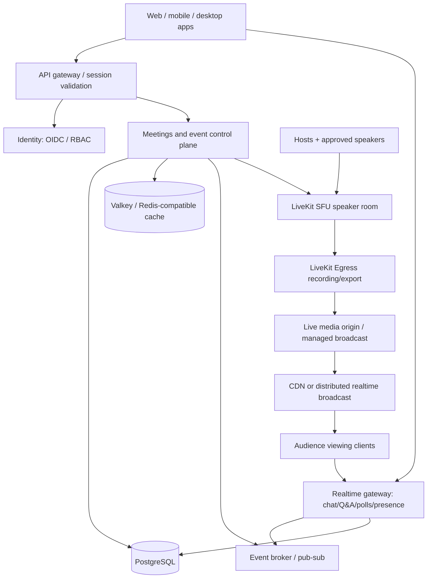

# MegaMeet source-document snapshot — Part 2 of 5

Captured 2026-11-16; current main-branch files at tree dd2284f26f7822c086bef5070839364e42c01d8f. Archival copies; source files remain authoritative. This part covers architecture, roadmap, stack, licensing, security/privacy, and 100K plan.

## docs/ARCHITECTURE.md

Original: https://github.com/arunabanarjee32-bit/google-meet/blob/main/docs/ARCHITECTURE.md  
Blob SHA: 1855eb6f73e1a8e401521e59e16d885c4f594cc4

~~~~markdown
# Proposed system architecture

**Document type:** reference design; **not implemented**. Final component choices need architecture decision records (ADRs), license reviews and performance tests.

## One application, separate media paths



**Two modes, one event identity:**

1. **Interactive meeting:** bounded participants communicate via SFU; host permissions and SDK subscription strategies control what each client sends and receives.
2. **Large event:** a limited group of live speakers publishes to an SFU; output is encoded/exported for distributed delivery, while audience chat, polls, Q&A and attendance use independent services. Participants belong to the same **logical event**, not necessarily the same media room.

No browser must subscribe to 100,000 distinct camera feeds. A fully interactive 100K-way room is not the stated target.

## Monorepo proposal (future layout)

```text
apps/
  web/                 # browser UI and guest join
  mobile/              # React Native, later milestone
  desktop/             # optional packaged shell, later
  admin/               # organization/admin experience
services/
  api/                 # control APIs and session orchestration
  chat/                # persistence, moderation, gateways
  event-control/       # stage roles, attendance, Q&A, polls
  recording/           # jobs, permissions, artifact lifecycle
  broadcast/           # provider adapters and health checks
  ai/                  # optional consent-based pipelines
packages/
  ui/                  # design system
  contracts/           # API types and schema
  auth/                # shared authorization helpers
  config/              # validated runtime config
infra/                 # reproducible local/prod definitions
docs/                  # decisions and runbooks
```

This is a proposed directory plan; do not scaffold empty services until milestones require them.

## Important contracts

- **Identity and access:** OIDC for people; server-signed short-lived tokens for media rooms/events. Distinguish `host`, `moderator`, `speaker`, `attendee`, `viewer`. Treat every role elevation as an audited backend decision.
- **Meeting service:** create, schedule, join, revoke, end; event/room ID mapping; capacity and region policy; idempotent API operations.
- **Media adapter:** join room, publish/subscribe, egress recording/broadcast, monitor quality. Never expose media provider secrets to clients.
- **Broadcast adapter:** start/stop output, signed viewer access, latency metadata, stream state, provider quotas, errors; support replaceable managed providers and future self-hosting.
- **Interaction plane:** per-event channels for chat/Q&A/polls/hand raises; bounded message sizes; rate limits; moderation; fanout sharding; ordering expectations explicit.
- **Persistence:** PostgreSQL for canonical user/organization/event/permission/recording metadata; object storage for recordings; cache for short-lived presence/session state. Avoid storing all high-frequency presence events as DB rows.
- **Events:** define idempotency keys, schema versioning, retries, dead-letter behavior and metrics for meeting.started, participant.joined, stage.requested, stage.approved, stream.failed, recording.started and meeting.ended.

## Trust boundaries

Client inputs are untrusted. Enforce meeting admission, speaker promotion, recording access, moderation, webhook authentication and tenant isolation on the server. Support signed playback, consent, deletion/retention, audit logs, abuse detection and least privilege. Consider TURN for NAT traversal if self-hosting. See [Security and privacy](SECURITY_PRIVACY.md).

## Scale and latency caveats

A CDN helps distribute video; it does **not** independently solve chat, presence, moderation, synchronized stage promotion or record permissions. Egress is not a CDN. HLS/LL-HLS and WebRTC distribution have different latency/cost/device tradeoffs. Treat these as product modes with explicit user-facing behavior.

Use load tests for join bursts, steady state, reconnect storms, live stage swaps, regional degradation, and authentication/messaging workloads; see [100K design](SCALABILITY_100K.md).

## Architecture decisions required

- ADR-0001: One monorepo and external services, not several merged meeting apps.
- ADR-0002: LiveKit for interactive meeting foundation (pending license and cost signoff).
- ADR-0003: Broadcast provider/CDN vs self-hosted origin; latency and viewer-hour cost assumptions.
- ADR-0004: Identity provider vs application-level authentication, retention and regional data constraints.
- ADR-0005: Licensing/brand strategy before original source code contributions.

A proposal or ADR must record alternatives, benefits, costs, risks and rollback/migration options.

~~~~

---

## docs/ROADMAP.md

Original: https://github.com/arunabanarjee32-bit/google-meet/blob/main/docs/ROADMAP.md  
Blob SHA: f5a486b6adcc656f8a1656ac6446d9a6a12d2988

~~~~markdown
# Development roadmap and contributor work packages

**All phases are proposed unless linked to completed code/tests.** Milestone durations are intentionally omitted until staffing, budgets and dependency choices are known. Each stage needs an owner, acceptance tests and written go/no-go decision.

## Phase 0 — Foundation, legal and validation (first)

- Confirm target audience, first customer segment and product name.
- Decide whether original code will be open-source, source-available or proprietary; publish appropriate LICENSE and contribution terms.
- Audit LiveKit Meet, LiveKit server/components/ingress/egress, and shortlisted dependencies for exact licenses, maintenance, security and integration effort.
- Write architecture decision records (ADR), threat model, initial cost model and vendor comparison.
- Determine MVP measurable outcomes and test device/browser matrix.
- Create repo issue templates, pull request workflow and CI design.

**Gate:** licensed component shortlist; owner-approved architecture; no unresolved high-risk reuse claims.

## Phase 1 — Working small meeting

- Create a reproducible TypeScript monorepo and deployable Next.js web app, based on licensed upstream LiveKit Meet design/code only after the audit.
- Introduce environment schema validation, lint/type/test pipeline, logging and observability.
- Server-side session/token issuance, basic accounts and meeting creation/join.
- Camera, microphone, screen sharing, participant roster and host permissions.
- Reconnect handling, device/browser compatibility tests, security baseline.

**Gate:** reproducible local/demo run; two actual browsers can meet securely; permissions and smoke tests pass.

## Phase 2 — Competitive meeting experience

- Scheduling/calendar integrations and invites.
- Persistent moderated meeting chat, reactions, raise hand, polls and Q&A.
- Recording/Egress with informed consent, artifact policies and playback.
- Whiteboard, collaborative notes, captions/a11y, keyboard and screen-reader testing.
- Quality improvements: network adaptation, device switching, low-bandwidth mode.

**Gate:** feature flows work end-to-end, accessibility and privacy checks pass.

## Phase 3 — Large-event MVP

- Separate event and stage roles with signed viewer admission.
- Egress-to-CDN broadcast, health checks, adaptive streaming, regional delivery.
- Scalable chat/Q&A/polls, stage promotion, moderation and analytics.
- Explicit latency modes and graceful fallbacks.
- Load-test gate with 100–1K viewers and step up to 10K.

**Gate:** event operations runbook, validated 10K audience test and cost model. This is not yet 100K.

## Phase 4 — Organization, AI and business

- Workspace administration, SSO/SCIM evaluation, policies, audit logs and retention.
- Optional consent-based transcripts, summaries, translated captions.
- API/webhooks, usage metering, billing and customer support tooling.
- Mobile apps; desktop packaging only if demanded by users.

**Gate:** enterprise security and privacy review; customer trial and operational support.

## Phase 5 — 100K event hardening and launch

- Load/failure drills at 50K and 100K actual stream viewers in approved regions.
- Provider quota confirmation, reliability SLO, autoscaling tests, anti-abuse and incident response.
- Production deployment, backups, restore tests, support rotation, billing alerts and legal review.

**Gate:** reproducible, independently reviewed, real viewer-capacity evidence and budget approval; only then market the tested capacity.

## Good first issues for contributors

- Audit and document current upstream version/license inventory.
- Create ADR proposals for self-hosted vs managed delivery and latency modes.
- Build a minimal repository skeleton with one web app and tests (after owner license decision).
- Define JSON schemas for join token and stage-role actions, with server-side authorization.
- Implement a read-only developer-facing architecture and threat-model review.
- Define a load-test method that distinguishes real playback from synthetic clients.

## How to prioritize work

Issue proposals should include: user problem, milestone, proposed reuse, dependency/license evidence, scope, acceptance tests, risk, cost, and an out-of-scope section. Prefer vertical slices shipped behind feature flags over hundreds of empty folders. See [Contributing](../CONTRIBUTING.md).

~~~~

---

## docs/TECH_STACK.md

Original: https://github.com/arunabanarjee32-bit/google-meet/blob/main/docs/TECH_STACK.md  
Blob SHA: 836bed6b17f320320fa0d5afdde6a32e674681c3

~~~~markdown
# Open-source reuse and technology decision matrix

**Last surveyed: 2026-11-14.** These are shortlisted components, not installed dependencies or commitments. Licenses below reflect GitHub's repository metadata as checked on that date and **must be independently verified against the exact version, subpackages, NOTICE files and commercial use context**.

## Guiding choice: one product, not a pile of applications

Use **one main application monorepo**. Integrate mature packages and deployable services at defined interfaces. Do not merge the Jitsi, BigBlueButton, LiveKit and other complete conferencing applications into one overlapping codebase. Build differentiated orchestration and UX instead of a new SFU.

| Function | Shortlist / repo | Reported license | Proposed use |
| --- | --- | --- | --- |
| Meeting UI starter | [livekit-examples/meet](https://github.com/livekit-examples/meet) | Apache-2.0 | Reference/front-end starter; customize after audit |
| Real-time media | [livekit/livekit](https://github.com/livekit/livekit) | Apache-2.0 | SFU / room infrastructure |
| UI components | [livekit/components-js](https://github.com/livekit/components-js) | Apache-2.0 | Device, room and media controls |
| Recording/export | [livekit/egress](https://github.com/livekit/egress) | Apache-2.0 | Egress/recording; not a CDN |
| RTMP/WHIP ingestion | [livekit/ingress](https://github.com/livekit/ingress) | Apache-2.0 | Optional encoder/OBS ingestion |
| Authentication / SSO | [keycloak/keycloak](https://github.com/keycloak/keycloak) | Apache-2.0 | Evaluate for organizations/OIDC |
| Real-time messaging | [centrifugal/centrifugo](https://github.com/centrifugal/centrifugo) | Apache-2.0 | WebSocket fanout; persist/moderate separately |
| Whiteboard | [excalidraw/excalidraw](https://github.com/excalidraw/excalidraw) | MIT | Whiteboard integration subject to package audit |
| Collaborative state | [yjs/yjs](https://github.com/yjs/yjs) | GitHub: NOASSERTION | Audit actual source/package license before adopting |
| Calendar UI | [fullcalendar/fullcalendar](https://github.com/fullcalendar/fullcalendar) | MIT (repo) | Standard/calendar UI; premium separately licensed |
| Cache | [valkey-io/valkey](https://github.com/valkey-io/valkey) | BSD-3-Clause | Redis-compatible cache and ephemeral state |
| Self-hosted media origin option | [ossrs/srs](https://github.com/ossrs/srs) | MIT | Evaluate for origin; CDN capacity is separate |
| Mobile media SDK | [livekit/client-sdk-react-native](https://github.com/livekit/client-sdk-react-native) | Apache-2.0 | Later mobile support |
| Agent framework | [livekit/agents](https://github.com/livekit/agents) | Apache-2.0 | Optional AI pipeline |
| Speech transcription | [openai/whisper](https://github.com/openai/whisper) | MIT | Optional speech-to-text evaluation |
| Product analytics | [umami-software/umami](https://github.com/umami-software/umami) | MIT | Optional metrics; respect consent/privacy |
| Subscription billing | [killbill/killbill](https://github.com/killbill/killbill) | Apache-2.0 | Evaluate at paid launch; may be too heavy initially |
| Load testing | [locustio/locust](https://github.com/locustio/locust) | MIT | API/WebSocket load, not proof of video playback |

## Broadcast: choose explicitly, don't blindly stack everything

- **Managed first candidate:** AWS IVS or Cloudflare Stream for edge delivery at 100K+ audience ambitions; evaluate actual quotas, available protocols, latency, access control, privacy, cost and product limits.
- **Self-hosted evaluation:** SRS as origin plus distribution/CDN; requires operations expertise, testing and support. An origin is not a magically scalable global network.
- **LiveKit Egress** may export the speaker feed, but a broadcast provider/CDN must handle audience distribution.
- **Do not choose both managed broadcast vendors in the first milestone** unless failover requirements justify complexity.

## Alternatives requiring elevated license diligence

- [OvenMediaEngine](https://github.com/AirenSoft/OvenMediaEngine) has AGPL-3.0 licensing in the reviewed public ecosystem; don't silently embed it in proprietary code.
- [tldraw](https://github.com/tldraw/tldraw): licensing is not a blanket permissive MIT grant for production commercial embedding.
- [Cal.com](https://github.com/calcom/cal.com): AGPL/commercial module distinctions.
- [Novu](https://github.com/novuhq/novu): edition and module licenses need verification.
- [Coturn](https://github.com/coturn/coturn): useful TURN option; verify exact licenses/deployment.
- Entire app alternatives (Jitsi Meet, BigBlueButton, Owncast) may be studied for product patterns, but do not merge their core media engines without architecture and legal review.

## Selection checklist for every dependency

- Exact git tag, package name, version, SPDX/license text, notices and dependencies.
- Compatibility with intended proprietary or public distribution model.
- Maintenance, security posture, release cadence, API stability, support needs.
- Expected engineering hours for integration/upgrade, monthly hosting and vendor costs.
- Replaceability, observability and rollback.
- Unit/integration/security/load-test plan.

Store decisions in ADRs; keep a machine-readable software bill of materials once code exists. See [Licensing](LICENSING.md).

~~~~

---

## docs/LICENSING.md

Original: https://github.com/arunabanarjee32-bit/google-meet/blob/main/docs/LICENSING.md  
Blob SHA: c0811d212ae456acc193d27ad95a513b6b365870

~~~~markdown
# Licensing, branding and third-party compliance

**The owner has not selected a license for MegaMeet's original code.** This is a governance blocker before substantive source-code contribution or external redistribution. A public GitHub repository with no LICENSE file should not be interpreted as unrestricted open-source permission.

## Immediate decisions needed from the project owner

1. Decide between open-source, source-available and proprietary distribution, with legal review.
2. Choose a compatible license (if open-sourcing), contribution agreement/DCO approach, copyright policy and any trademark policy.
3. Decide who can accept contributions and how third-party notices are preserved.
4. Confirm the final product name and run trademark clearance. The repository path contains `google-meet`, but this project must not claim association with Google or use confusing Google Meet marks.

Until those decisions, contributors should begin with **issues, documentation corrections and architectural proposals**; maintainers should pause substantial source-code reuse submissions requiring a license grant.

## Upstream components vs your original product

Running or modifying third-party projects does not transfer their copyrights. A new brand, deployment, custom APIs and original application code may be under your control while integrated upstream packages remain under their own licenses. AI-assisted output may have special contractual/legal nuances; don't guarantee copyright or exclusivity without review.

## Verification procedure

For each imported dependency, record: upstream URL; exact version/commit/package; full LICENSE and NOTICE; source/modification notices; transitive dependencies; commercial use terms; whether server/network-access obligations apply; and whether trademark or patent grants matter.

- Prefer permissive, well-maintained components when technically appropriate.
- Apache-2.0 requires license/notice compliance and may include patent terms.
- MIT and BSD variants require preservation of appropriate notices.
- AGPL and other copyleft licenses require careful evaluation for a hosted commercial service; do not assume they cannot be used, nor assume there are no obligations.
- Multi-license and open-core projects may license premium components separately.
- Re-evaluate on version upgrades and include a dependency license report in CI once code exists.

## Initial candidate inventory

See [Technology matrix](TECH_STACK.md), where licenses are explicitly labelled as *GitHub repository metadata* checked on 2026-11-14, not final legal approval. Particularly verify Yjs's packaged license (GitHub reports NOASSERTION), and any licenses for diagrams, fonts, media assets, translations, transcription models, and mobile SDK transitive packages.

## Contributor guidance

Do not copy code from Zoom, Teams, Meet, proprietary designs, or random public GitHub repositories. Link to a reusable project's license and use package/service integrations when possible. Never put secrets, credentials, recorded meetings, personal data, or third-party assets without rights in this public repo.

**This is project-planning guidance, not legal advice.** License choice is a maintainer decision requiring competent review.

~~~~

---

## docs/SECURITY_PRIVACY.md

Original: https://github.com/arunabanarjee32-bit/google-meet/blob/main/docs/SECURITY_PRIVACY.md  
Blob SHA: 559bbce22770c0eb9cf901588130842e1529f944

~~~~markdown
# Security, privacy and abuse-prevention baseline

**Status: requirements and threat model; not an implemented security program.** Security reviews must be conducted on actual code and production deployments.

## Core threats

- Unauthorized entry via guessed/leaked meeting IDs, stolen media tokens and weak guest links.
- Cross-organization data leaks, insecure direct-object reference, role escalation.
- Rogue attendees publishing media, hijacking screen shares or triggering recording.
- Leaked recordings, retention violations, transcript/model data disclosures.
- Join storms, credential abuse, bot swarms, chat spam, message amplification and DDoS.
- WebSocket replay, untrusted webhook payloads, malicious file uploads, XSS/CSRF/SSRF.
- Supply-chain compromise and leaked vendor credentials in CI or commit history.
- Unclear consent for recording, transcript, AI use and third-party processors.

## Required controls

| Area | Required behavior |
| --- | --- |
| Identity | OIDC, secure sessions, optional MFA/SSO, verified tenant boundaries |
| Admission | Unpredictable identifiers, waiting rooms and policies, expiring guest tokens |
| Authorization | Server-side RBAC/ABAC, least privilege, audited promotion and revocation |
| Media | Short-lived scoped LiveKit tokens, TLS/SRTP transport, configured TURN where needed |
| Recording | Off by default; visible consent/notice, scoped storage and playback, expiry |
| Data | Encryption in transit/at rest, retention/delete/export workflow, minimal collection |
| Realtime | Message size/rate limits, authorization for subscriptions, moderator controls |
| APIs | Input validation, parameter authorization, throttles, idempotency, structured audit |
| Secrets | Secrets manager, environment validation, rotation, no tokens in source/console logs |
| Infrastructure | Least-privilege IAM, patching, dependency scans, backups, restoration drills |
| AI | Explicit opt-in, disclosed processors/regions, transcript controls and access logging |
| Clients | Secure headers, CSP as appropriate, safe URL handling and mobile permission UX |

**Do not claim end-to-end encryption.** WebRTC transport encryption and a server-side media SFU/egress can protect transport while still allowing server-side processing; true E2EE requires a separately designed and tested key model and may conflict with server recording/AI.

## Large-event specifics

- Gate viewer access with signed tickets; never let audience tokens publish to the stage.
- Prevent accidental echo when a viewer is promoted from delayed broadcast to real-time speaker.
- Distinguish public attendee count from private user presence records; minimize exported PII.
- Use moderation queues, anti-spam and per-event quota guards for 100K fanout.
- Set hard limits on AI processing, stream transcoding and recordings to control abuse/cost.

## Privacy/product decisions the owner must make

Data-controller obligations and jurisdiction, hosting geography, cookie/analytics policy, guest retention, meeting retention, public-recording discoverability, minors, request fulfillment and organizational legal holds. No regulatory compliance claim should be made without validation.

## Security release gate

Complete code review, SAST/dependency scan, authZ/tenant isolation tests, secrets scan, incident-response playbook, backup/restore test, DDoS risk assessment, independent penetration test and privacy impact review appropriate to deployment.

Report security issues using [SECURITY.md](../SECURITY.md); never put exploits, passwords or personal recordings in public GitHub issues.

~~~~

---

## docs/SCALABILITY_100K.md

Original: https://github.com/arunabanarjee32-bit/google-meet/blob/main/docs/SCALABILITY_100K.md  
Blob SHA: 36cd41215d0988630000d04a97914d895d507bd5

~~~~markdown
# 100,000+ audience system: engineering and validation plan

**This is a target, not an existing capability.** One logical event with 100K viewers means most are audience-only; a smaller bounded stage publishes audio/video in real time. It is not technically or economically equivalent to 100K people publishing 100K cameras to each other.

## Media delivery model

1. Host and approved presenters publish to a LiveKit SFU stage using WebRTC.
2. A controlled composite or selected program feed is exported via egress.
3. A managed broadcast service or verified origin/CDN fans the encoded stream out across regions.
4. Viewers subscribe to the broadcast (adaptive variants and signed access).
5. A separately scaled event-control plane handles join auth, moderation, polls, Q&A, chat and hand-raise.
6. A viewer who becomes a speaker switches to a short-lived authorized stage session; remove broadcast audio when appropriate to avoid echo and rebroadcast delay.

The actual product must specify whether viewer latency is seconds (e.g. LL-HLS) or low-latency WebRTC and handle stage/broadcast clock differences. Do not promise sub-second delivery without evidence.

## Capacity calculations (planning illustrations)

At 100,000 concurrent viewers watching an average **1 Mbps** encoded stream:

- Aggregate distribution: **100 Gbps**.
- 60-minute event transfer: about **45 TB** (decimal), *before overhead and variant/quality effects*.
- At 2 Mbps average: about **200 Gbps** and **90 TB** per hour.
- 100K authenticated joined viewers also create identity, WebSocket, presence, heartbeat and API load unrelated to video bytes.

These are bandwidth/data quantities, **not dollar quotes**. A CDN/media provider must explicitly support the regional concurrency, ingest/egress and billing. Evaluate peak join rate, not just total viewers.

## Reliability and protective design

- Admission control and queueing for burst joins; short-lived signed event/video tokens.
- Regional edge distribution, health checks, origin protection and provider quotas.
- CDN/video fallback strategy; test recoverability when broadcast fails.
- Rate limits, per-event moderation thresholds, slow mode, spam protection, queue caps.
- Aggregate and sample presence counters rather than broadcasting every join to everyone.
- Separate chat partitions/shards from video infrastructure; protect databases from hot-key write storms.
- Backpressure, bounded queues, retry policies and late-join idempotency for Q&A/polls.
- Telemetry: successful viewers, active speakers, join latency, start failures, buffering, media bitrate, error rates, server saturation, moderated events.
- Consent, privacy, anti-abuse and retention policies must scale too.

## Test ladder

| Gate | Test | Evidence required |
| --- | --- | --- |
| A | 2–25 interactive participants | Functional AV/host-control tests |
| B | 100–1,000 audience viewers | Real playback + join/leave, moderated chat tests |
| C | 10,000 audience viewers | Verified media delivery and multi-service soak test |
| D | 50,000 audience viewers | Regional load/failure, burst and cost evidence |
| E | 100,000+ audience viewers | Concurrent *actual playback*, audited metrics, quota and cost validation |

At every gate: report deployment version, locations, device/network profile, measured concurrency, duration, RTT/latency, failure percentage, rebuffers, p95/p99 join time, bills and infrastructure diagrams. Synthetic fake clients may load API/chat but **do not prove media viewing capacity**.

## Failure drills

- SFU stage loss while a CDN stream is in progress.
- Egress interruption, broadcast origin outage and viewer reconnect storm.
- A sudden 100K join surge, a malicious chat flood, Q&A moderation backlog.
- Promotion race: two moderators approve the same viewer simultaneously.
- Multi-region network partition, stale role tokens, billing limit and provider throttling.
- Recording/storage failure with visible and correct client state.

## Go/no-go

Do **not** advertise a 100K guarantee until an accepted Gate E run exists for the advertised delivery mode, with legal/financial approval, operational runbooks, abuse response and support staffing. Keep a smaller published limit until then.

See [Architecture](ARCHITECTURE.md), [Costs](COST_MODEL.md), [Security](SECURITY_PRIVACY.md), and [Roadmap](ROADMAP.md).

~~~~

---

